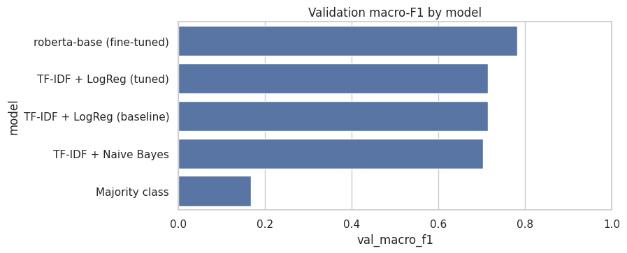
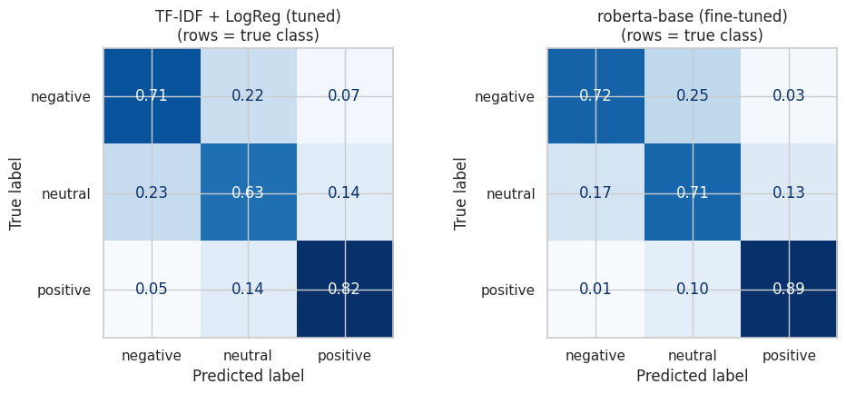
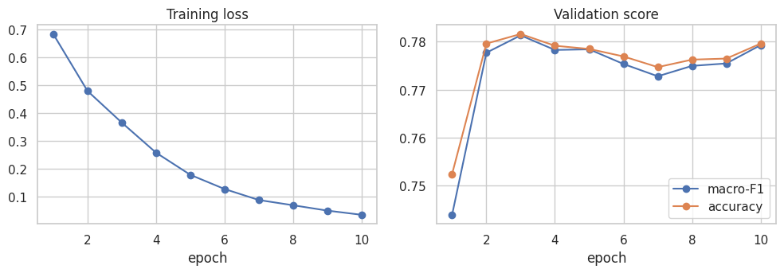
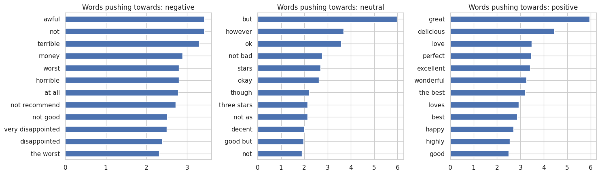
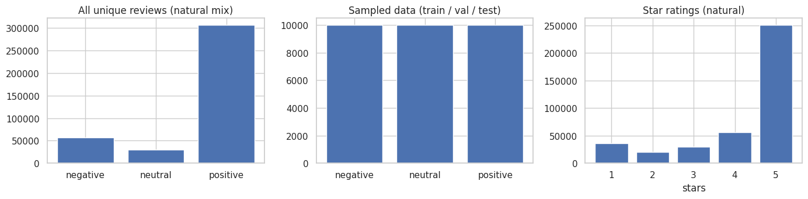

# E-commerce Review Sentiment Classifier

Classifies product reviews as **negative**, **neutral** or **positive** (from star ratings: 1-2 = negative, 3 = neutral, 4-5 = positive). A **RoBERTa-base** model is fine-tuned on Amazon Fine Food Reviews and compared with a TF-IDF + Logistic Regression baseline. Both models are served in a **Streamlit** app.

**Live demo:** _add your link here after deploying_

<!--  -->

## Results at a glance

| Model | Test accuracy | Test macro-F1 | Natural-mix accuracy | Natural-mix macro-F1 | Tweets macro-F1 | ms / review |
|---|---|---|---|---|---|---|
| Majority class | 0.333 | 0.167 | 0.782 | - | - | - |
| TF-IDF + Naive Bayes | - | 0.703 (val) | - | - | - | - |
| TF-IDF + Logistic Regression (tuned) | 0.720 | 0.720 | 0.769 | 0.634 | 0.352 | 0.14 |
| **RoBERTa-base (fine-tuned)** | **0.773** | **0.773** | **0.856** | **0.721** | **0.535** | 7.70 |

- **Test set:** 4,500 reviews, perfectly balanced (1,500 per class), so accuracy and macro-F1 are directly comparable.
- **Natural mix:** 5,000 reviews with the real class split (14.3% negative, 7.5% neutral, 78.2% positive), kept apart from training. Because a model that always says "positive" already gets 78.2% accuracy here, **macro-F1 is the number to read**.
- **Tweets:** 3,000 TweetEval tweets, never seen in training, to test how well the models carry over to a different domain.
- Speed is the per-review prediction time measured in the Kaggle notebook; it varies with hardware.



### Key findings

1. **Fine-tuning helps by about 5 macro-F1 points** (0.773 vs 0.720) on the balanced test set. It is about 53x slower per review (7.7 ms vs 0.14 ms), so the baseline is still a reasonable choice when latency or cost matters.
2. **Neutral (3-star) is the hardest class** for both models: F1 0.635 for Logistic Regression and 0.688 for RoBERTa, against 0.808 and 0.871 for positive. Star ratings are a noisy label for "neutral": many 3-star reviews are mixed or mildly positive/negative.
3. **On the real class mix the gap widens**: macro-F1 0.721 vs 0.634. Neutral precision is low for both models (0.335 for RoBERTa, 0.258 for Logistic Regression) because neutral is only 7.5% of real reviews, so even a small error rate on the other classes produces many false "neutral" predictions. Calibrate or re-threshold if you deploy on the real distribution.
4. **Domain transfer is weak, but fine-tuning transfers better**: on tweets macro-F1 drops from 0.773 to 0.535 for RoBERTa (-0.237) and from 0.720 to 0.352 for Logistic Regression (-0.368). These models are made for product reviews, not tweets.
5. **Tuning the linear model did not help**: the grid search chose the same settings as the default (C = 1, unigrams + bigrams, 50k features), so validation macro-F1 stayed at 0.713. Removing stopwords made it worse (0.687), because words like "not" carry sentiment.

### Per-class test results

| Class | LogReg precision / recall / F1 | RoBERTa precision / recall / F1 |
|---|---|---|
| negative | 0.718 / 0.714 / 0.716 | 0.803 / 0.721 / 0.759 |
| neutral | 0.640 / 0.630 / 0.635 | 0.670 / 0.708 / 0.688 |
| positive | 0.800 / 0.817 / 0.808 | 0.852 / 0.890 / 0.871 |



## Fine-tuning the transformer

`roberta-base`, trained on 21,000 reviews (7,000 per class), validated on 4,500, with these settings:

| Setting | Value |
|---|---|
| Optimiser | AdamW, learning rate 3e-5, weight decay 0.01 |
| Schedule | 6% linear warm-up, then linear decay |
| Batch size / max length | 32 / 128 tokens |
| Epochs | 10, keeping the checkpoint with the best validation macro-F1 |
| Precision / stability | fp16 mixed precision, gradient clipping at 1.0 |
| Training time | 30.5 minutes on one Kaggle GPU |



| Epoch | Train loss | Val accuracy | Val macro-F1 |
|---|---|---|---|
| 1 | 0.683 | 0.752 | 0.744 |
| 2 | 0.479 | 0.780 | 0.778 |
| **3** | **0.366** | **0.782** | **0.781** |
| 5 | 0.179 | 0.778 | 0.778 |
| 10 | 0.036 | 0.780 | 0.779 |

Training loss keeps falling to 0.04 while validation macro-F1 stays flat from epoch 2 onwards (0.773-0.781): the model memorises the training set without learning anything more. The saved model is the epoch-3 checkpoint. **3 to 4 epochs are enough**, which would cut training time to roughly a third; the 10-epoch run is kept here because it is what produced these numbers.

## Error analysis

Of the 4,500 test reviews, RoBERTa misclassified 1,022 (22.7%). Most mistakes are between neighbouring classes:

| True class | Predicted | Count |
|---|---|---|
| negative | neutral | 375 |
| neutral | negative | 250 |
| neutral | positive | 188 |
| positive | neutral | 149 |
| negative | positive | 44 |

Only 44 reviews are confused across the full range (negative predicted as positive). Reading the errors, many are label noise rather than model failure: a 3-star review such as *"I did not like these beans and won't be purchasing them again. They were bland..."* reads as negative, and *"Surprisingly mellow coffee ... I recommend this"* reads as positive. The Logistic Regression model also fails on negation it cannot compose: *"not bad at all"* is classified as negative (62%), because it sees the words "bad" and "not" separately from "not bad".



## The data

[Amazon Fine Food Reviews](https://www.kaggle.com/datasets/snap/amazon-fine-food-reviews): 568,454 reviews. Median review length is 62 words, and 28.7% are longer than the 128-token limit and are truncated.

| Step | What was done | Why |
|---|---|---|
| Duplicates | 175,320 duplicate review texts removed, leaving 393,134 | The same review must not appear in both train and test |
| Class mix | Natural: 14.5% negative, 7.6% neutral, 77.9% positive | Strongly imbalanced, so accuracy alone is misleading |
| Natural holdout | 5,000 reviews set aside first | Honest check on the real class mix |
| Balanced sample | 10,000 per class = 30,000 reviews, split 70/15/15 (21,000 / 4,500 / 4,500) | The model must learn the minority classes |
| Cleaning | HTML tags removed, entities decoded | Raw text contains `<br />` and similar |



## Project structure

```
ecommerce-review-sentiment/
├── app.py                              # Streamlit app (run this)
├── requirements.txt                    # one file for the notebook and the app
├── README.md
├── .gitignore
├── notebooks/
│   └── train_review_sentiment.ipynb    # EDA, baselines, fine-tuning, evaluation; writes models/ and assets/
├── src/
│   ├── __init__.py
│   └── text_utils.py                   # text cleaning + prediction explanations, shared by notebook and app
├── data/
│   └── sample_reviews.csv              # try this in the app's batch tab (put Reviews.csv here for local training)
├── models/                             # generated by the notebook: lr_pipeline.joblib, transformer/, metadata.json
└── assets/                             # figures from the training run (used in this README)
```

`models/` is empty until you add the trained models (the notebook creates them; the app needs them). The figures in `assets/` come from the run reported above.

## Quickstart

### 1. Install

Python 3.10 or newer.

```bash
python -m venv .venv
source .venv/bin/activate            # Windows: .venv\Scripts\activate
pip install -r requirements.txt
```

### 2. Get the models

**Option A: use the models you trained on Kaggle.** Unzip the downloaded `models.zip` so that `models/lr_pipeline.joblib`, `models/metadata.json` and `models/transformer/` sit next to `app.py`. The transformer is about 500 MB.

**Option B: train again.**

- *Kaggle (recommended, free GPU):* create a notebook from `notebooks/train_review_sentiment.ipynb`, add the Amazon Fine Food Reviews dataset as input, switch on a GPU, run all cells, and download `models/` and `assets/`. With two T4 GPUs, `USE_ALL_GPUS = True` trains on both (the reported run used one GPU).
- *Locally:* put `Reviews.csv` in `data/` and run the notebook from the `notebooks/` folder. Without a GPU set `TRANSFORMER_TRAIN_SIZE = 3000`, or `RUN_TRANSFORMER = False` to skip the transformer (the app then offers only Logistic Regression).

### 3. Run the app

```bash
streamlit run app.py
```

It opens at <http://localhost:8501>.

## The app

| Tab | What it does |
|---|---|
| **Single review** | Prediction, confidence, class probabilities, and (for Logistic Regression) a chart of the words that drove the prediction |
| **Batch (CSV)** | Upload a CSV, pick the text column, classify every row, download the results |
| **Model report** | Metrics, per-class scores and figures from training |

Choose the model in the sidebar. The scores shown come from `models/metadata.json`.

## Troubleshooting

| Problem | Fix |
|---|---|
| App says `models/lr_pipeline.joblib` not found | Put the unzipped `models/` folder next to `app.py` |
| Only Logistic Regression in the sidebar | `models/transformer/` has no `model.safetensors`, or PyTorch is not installed |
| Warning about a scikit-learn version mismatch | The model was trained on Kaggle with another scikit-learn version. Install the one in `models/metadata.json`, e.g. `pip install scikit-learn==1.x.x` |
| "CUDA out of memory" while training | Set `TRANSFORMER_BATCH = 16` |
| Notebook cannot find the data | Put `Reviews.csv` in `data/` or set `DATA_PATH` |
| `ModuleNotFoundError: src` | The `src/` folder must sit next to `app.py` |

## Deployment

Any host that can run `streamlit run app.py` works.

- `requirements.txt` includes PyTorch and Jupyter because it also covers training. A deployment serving only Logistic Regression needs just `streamlit`, `scikit-learn`, `pandas`, `numpy` and `joblib`.
- The RoBERTa weights (about 500 MB) are too large for plain git. `.gitignore` excludes them; use Git LFS, or upload the model to the Hugging Face Hub and set the environment variable `HF_MODEL_ID` to its name. CPU inference with RoBERTa is slower than the 7.7 ms measured on a GPU.
- Deployment and `HF_MODEL_ID` loading were not tested.

## Limitations

- Star ratings are a proxy for sentiment; neutral in particular is noisy, so part of the remaining error is label noise.
- Training on a class-balanced sample changes the class priors. On the real mix, neutral precision is low (0.335).
- Reviews of the same product can appear in both train and test; splitting by `ProductId` would remove this leak.
- Food products only, English only, a static snapshot. Performance on tweets is poor (macro-F1 0.535).
- The best epoch was chosen on the validation set, and the test set was not used for tuning. Results come from a single run with one random seed, so differences of about a point may be noise.