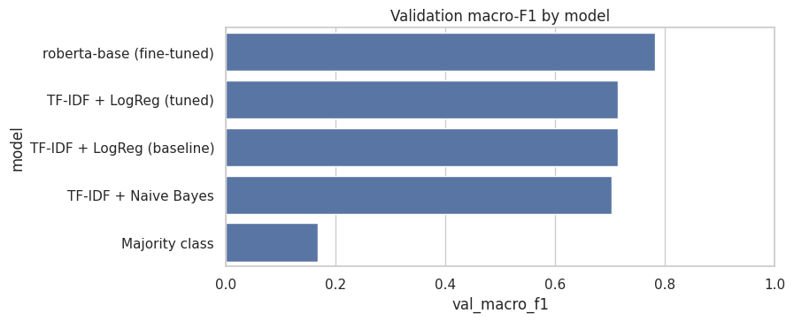
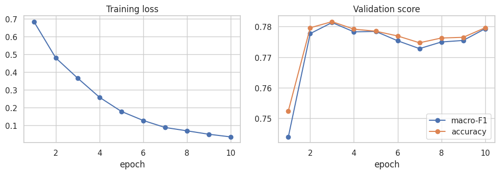

# E-commerce Review Sentiment Classifier

Classifies product reviews as **negative**, **neutral** or **positive** (1-2 stars = negative, 3 = neutral, 4-5 = positive). A **RoBERTa-base** model fine-tuned on Amazon Fine Food Reviews is compared with a TF-IDF + Logistic Regression baseline, and both are served in a **Streamlit** app.

## Results

| Model | Test accuracy | Test macro-F1 | Natural-mix macro-F1 | Tweets macro-F1 | ms / review |
|---|---|---|---|---|---|
| Majority class | 0.333 | 0.167 | - | - | - |
| TF-IDF + Logistic Regression | 0.720 | 0.720 | 0.634 | 0.352 | 0.14 |
| **RoBERTa-base (fine-tuned)** | **0.773** | **0.773** | **0.721** | **0.535** | 7.70 |

- **Test set:** 4,500 balanced reviews (1,500 per class).
- **Natural mix:** 5,000 held-out reviews with the real class split (14.3% negative, 7.5% neutral, 78.2% positive). Always predicting "positive" scores 78.2% accuracy here, so read macro-F1.
- **Tweets:** 3,000 TweetEval tweets, to test transfer to another domain.
- Speed was measured on a Kaggle GPU and varies with hardware.



### Key findings

1. **Fine-tuning adds about 5 macro-F1 points** but is about 53x slower per review, so Logistic Regression is still reasonable when latency or cost matters.
2. **Neutral is the hardest class** (F1 0.688 RoBERTa, 0.635 LogReg), partly because 3-star labels are noisy.
3. **On the real class mix, neutral precision is low** (0.335 RoBERTa, 0.258 LogReg) because neutral is only 7.5% of reviews. Re-threshold or calibrate before deploying on real traffic.
4. **Domain transfer is weak**: on tweets, macro-F1 drops to 0.535 (RoBERTa) and 0.352 (LogReg).
5. **Most errors are between neighbouring classes**; only 44 of 4,500 test reviews are negative predicted as positive.

## Training

`roberta-base`, 21,000 training reviews (7,000 per class), AdamW (lr 3e-5, weight decay 0.01), 6% warm-up then linear decay, batch size 32, max length 128, fp16, 10 epochs keeping the best validation macro-F1 (epoch 3, 0.781). Training took 30.5 minutes on one Kaggle GPU. Validation macro-F1 is flat after epoch 2, so 3-4 epochs are enough.



## Data

[Amazon Fine Food Reviews](https://www.kaggle.com/datasets/snap/amazon-fine-food-reviews): 568,454 reviews, 393,134 after removing duplicate texts and HTML. 5,000 reviews were held out with the natural class mix. The rest was sampled to 10,000 per class and split 70/15/15 into train, validation and test.

## Project structure

```
├── app.py                 # Streamlit app
├── requirements.txt
├── notebooks/train_review_sentiment.ipynb   # EDA, baselines, fine-tuning, evaluation
├── src/text_utils.py      # text cleaning + prediction explanations
├── data/sample_reviews.csv
├── models/                # generated by the notebook (lr_pipeline.joblib, transformer/, metadata.json)
└── assets/                # figures used in this README
```

## Quickstart

Requires Python 3.10+.

```bash
python -m venv .venv
source .venv/bin/activate        # Windows: .venv\Scripts\activate
pip install -r requirements.txt
```

**Get the models:** either unzip the `models.zip` from your Kaggle run next to `app.py`, or run the notebook (Kaggle with a free GPU is recommended; locally, put `Reviews.csv` in `data/`, and set `TRANSFORMER_TRAIN_SIZE = 3000` or `RUN_TRANSFORMER = False` without a GPU).

**Run the app:**

```bash
streamlit run app.py
```

Tabs: **Single review** (prediction, probabilities, word-level explanation for LogReg), **Batch (CSV)** (classify and download), **Model report** (metrics and figures).

## Troubleshooting

| Problem | Fix |
|---|---|
| `models/lr_pipeline.joblib` not found | Put the unzipped `models/` folder next to `app.py` |
| Only Logistic Regression in sidebar | `models/transformer/` lacks `model.safetensors`, or PyTorch is missing |
| scikit-learn version warning | Install the version listed in `models/metadata.json` |
| CUDA out of memory | Set `TRANSFORMER_BATCH = 16` |

## Deployment

Any host that runs `streamlit run app.py` works. A LogReg-only deployment needs just `streamlit`, `scikit-learn`, `pandas`, `numpy` and `joblib`. The RoBERTa weights (~500 MB) need Git LFS, or upload them to the Hugging Face Hub and set `HF_MODEL_ID`. Deployment and `HF_MODEL_ID` loading were not tested.

## Limitations

- Star ratings are a noisy proxy for sentiment, especially for neutral.
- Balanced training changes class priors, which hurts neutral precision on the real mix.
- Reviews of the same product can appear in both train and test; splitting by `ProductId` would remove this leak.
- Food products and English only; weak on tweets.
- Single run, one seed, so differences of about a point may be noise.